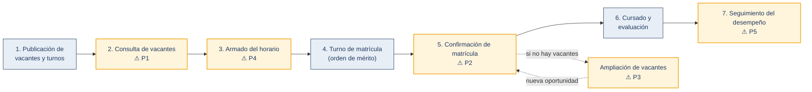
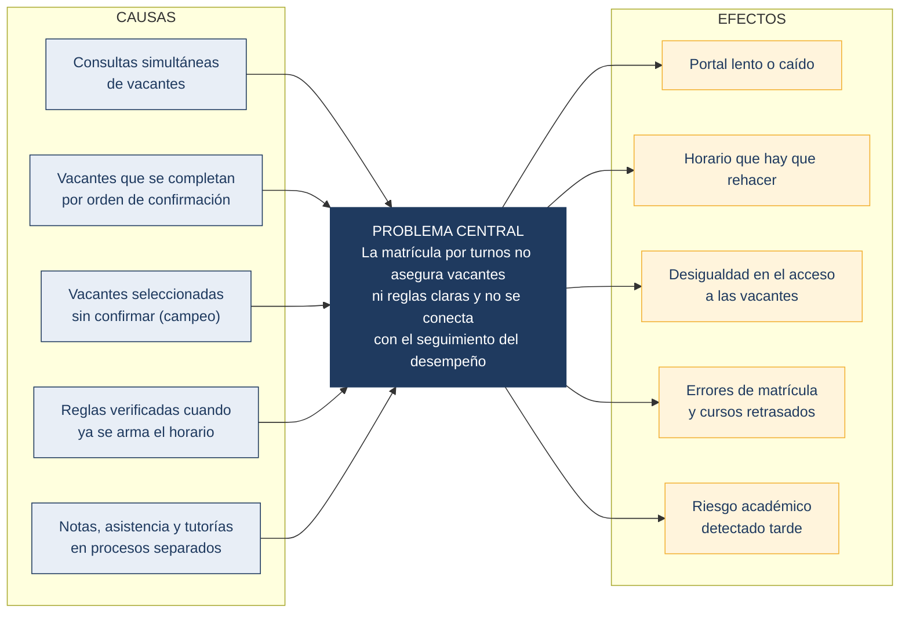

> [Capítulo I: Introducción](../../1.md) › [1.2. Solution profile](../1.2.md)

# 1.2.1. Antecedentes y problemática

## 1.2. Solution profile

### 1.2.1. Antecedentes y problemática

**Antecedentes**

**El abandono universitario en el Perú.** Permanecer hasta culminar la carrera es un reto sostenido de la educación superior peruana. Las cifras disponibles muestran una tendencia al alza.

| Indicador | Año | Porcentaje | Gráfico |
|---|---|---|---|
| Abandono universitario (jóvenes de 25 a 29 años) | 2012 | 15.8 % | ████████████████ |
| | 2018 | 17.6 % | ██████████████████ |
| Deserción acumulada total | 2016 | 15.3 % | ███████████████ |
| | 2017 | 17.4 % | █████████████████ |
| | 2018 | 15.7 % | ████████████████ |
| | 2019 | 19.3 % | ███████████████████ |

<em>Figura 1. Abandono y deserción universitaria en el Perú. Fuente: SUNEDU (2020) y Benites (2021), como se citaron en Dávila Morán et al. (2022).</em>

Entre las causas, un estudio con 45 exestudiantes de una universidad peruana encontró que los factores educativos (rendimiento, estrategias de estudio y falta de tutoría) fueron los de mayor incidencia percibida, y que el apoyo administrativo y académico también influye (Dávila Morán et al., 2022). Por su tamaño, la muestra no es generalizable.

**Cómo funciona la matrícula en la UNI.** El Reglamento de matrícula de estudiantes de antegrado (Universidad Nacional de Ingeniería [UNI], 2018) establece las siguientes reglas:

| Aspecto | Qué establece el reglamento |
|---|---|
| **Turnos** | Matrícula virtual en orden de mérito (promedio ponderado de los dos últimos periodos regulares), en la fecha y hora publicadas en el portal |
| **Vacantes** | Se fijan por curso-sección según la capacidad de las aulas, se completan por orden de matrícula y su variación la autoriza la Comisión de Matrícula |
| **Prerrequisitos** | No se puede matricular un curso sin haber aprobado su requisito |
| **Cruces de horario** | Se admiten como máximo dos cruces entre cursos de teoría, o de teoría con práctica o laboratorio |
| **Créditos** | El máximo depende del promedio ponderado (ver Tabla 1) |
| **Cursos desaprobados** | Tienen prioridad. La 2.ª desaprobación implica tutoría obligatoria, la 3.ª separación por un año y la 4.ª retiro definitivo |
| **Responsabilidad** | La matrícula es responsabilidad exclusiva del estudiante |

<em>Tabla 1. Máximo de créditos por promedio ponderado (UNI, 2018)</em>

| Promedio ponderado | 14 a 20 | 12 a menos de 14 | 10 a menos de 12 | 8 a menos de 10 | 0 a menos de 8 |
|---|---|---|---|---|---|
| **Máximo de créditos** | 28 | 26 | 24 | 20 | 15 |

**Proceso actual y dónde aparecen los problemas.** La Figura 2 resume el proceso y ubica los cinco problemas (P1 a P5) que se detallan más adelante.

<em>Figura 2. Proceso de matrícula por turnos y ubicación de los problemas. Elaboración propia con base en UNI (2018).</em>

**Tecnologías de apoyo.** La analítica del aprendizaje y los sistemas de alerta temprana se utilizan cada vez más en la educación superior para anticipar el riesgo de abandono y apoyar decisiones con datos (Setiawan et al., 2026). Esto respalda integrar los datos de matrícula y de desempeño en una sola plataforma.

---

**Aplicación de la técnica 5W + 2H**

| Pregunta | Respuesta |
|---|---|
| **¿Quién?** | Estudiantes de pregrado de la UNI. También docentes, tutores y comisiones de matrícula |
| **¿Qué?** | Cinco problemas en la matrícula por turnos y el seguimiento académico (P1 a P5) |
| **¿Dónde?** | Portal Web Sistema de Matrícula UNI y procesos de las escuelas profesionales, en Lima |
| **¿Cuándo?** | Cada semestre: antes y durante los turnos de matrícula, y a lo largo del ciclo para el desempeño |
| **¿Por qué?** | Muchos estudiantes compiten por vacantes limitadas que se completan por orden de confirmación, las reglas se verifican tarde y los datos de desempeño no se integran |
| **¿Cómo?** | Hoy el estudiante consulta vacantes, arma su horario por su cuenta y confirma en su turno. Si una sección se llena, rehace el horario |
| **¿Cuánto?** | Hasta 28 créditos por estudiante (UNI, 2018). A nivel nacional, la deserción acumulada llegó a 19.3 % en 2019. El impacto en la UNI se medirá en las entrevistas del Capítulo II |

---

**Problemática**

| N.° | Problema | Qué ocurre | Efecto |
|---|---|---|---|
| **P1** | Saturación del portal | Muchos estudiantes consultan las vacantes al mismo tiempo | Portal lento o caído |
| **P2** | Vacantes que desaparecen | Varios estudiantes del mismo turno ven la misma vacante y compiten por ella | Horario que hay que rehacer |
| **P3** | "Campeo" de vacantes | Se seleccionan cursos sin confirmar, a la espera de una ampliación con el docente preferido | Vacantes retenidas e injusticia para quienes sí matriculan |
| **P4** | Carga académica difícil de armar | Prerrequisitos, créditos y cruces se verifican cuando el horario ya está armado | Errores y cursos retrasados |
| **P5** | Seguimiento disperso | Notas, asistencia y tutorías están en procesos separados | Riesgo académico detectado tarde |

<em>Figura 3. Árbol de problemas de la matrícula por turnos. Elaboración propia.</em>

> **Planteamiento del problema.** La matrícula por turnos de la UNI no asegura que el estudiante consiga las vacantes que planificó ni facilita cumplir las reglas de su carga académica, y no se conecta con el seguimiento de su desempeño. Se requiere un sistema de información integrado que soporte la consulta masiva de vacantes, la asignación segura de cada una y el registro unificado del desempeño.

*Nota:* P1, P2 y P3 son observaciones de los integrantes. El reglamento respalda las reglas, pero no estas prácticas. Se validarán en las entrevistas.

**Qué se validará en las entrevistas**

| Problema | Indicador (Capítulo II) |
|---|---|
| **P1** | % de entrevistados que vio el portal lento o caído |
| **P2** | % que perdió una vacante al confirmar y tiempo para rehacer el horario |
| **P3** | % que practica el "campeo" y % que se vio perjudicado |
| **P4** | % que descubrió tarde un cruce, prerrequisito o límite de créditos |
| **P5** | % que recibió apoyo antes de desaprobar un curso |

---

**Referencias**

Dávila Morán, R. C., Agüero Corzo, E. C., Portillo Rios, H., & Quimbita Chiluisa, O. R. (2022). Deserción universitaria de los estudiantes de una universidad peruana. *Revista Universidad y Sociedad, 14*(2), 421–427. https://rus.ucf.edu.cu/index.php/rus/article/download/2722/2680/5329

Setiawan, R., Noersasongko, E., Syukur, A., Budiman, F., & Kurniadi, D. (2026). Imbalanced multi-class prediction of student drop-out and graduation: A systematic literature review. *ERIES Journal, 19*(1). https://www.eriesjournal.com/index.php/eries/article/download/2158/342/8614

Universidad Nacional de Ingeniería. (2018). *Reglamento de matrícula de estudiantes de antegrado* (Resolución Rectoral N.° 0275). https://fc.uni.edu.pe/wp-content/uploads/2021/06/reglamentodematriculajunio.pdf

[⬅️ Anterior](../1.2.md) | [🏠 Home](../../../README.md) | [Siguiente ➡️](../1.2.2/1.2.2.md)