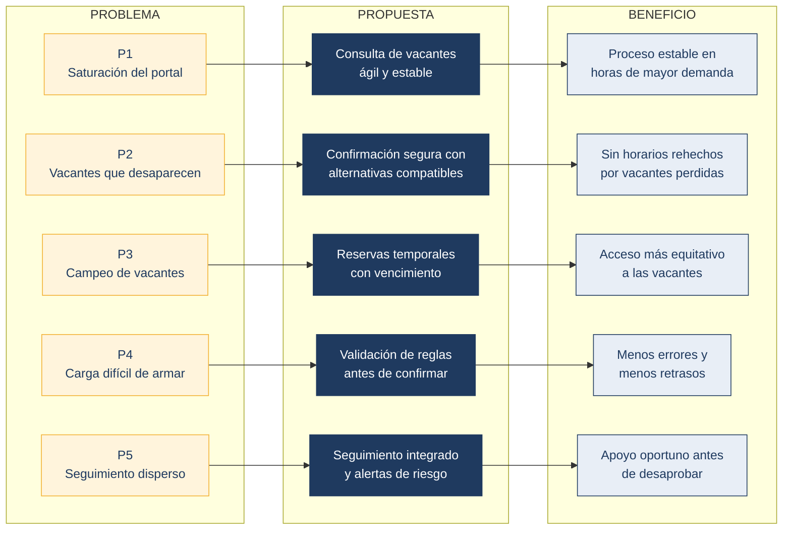

> [Capítulo I: Introducción](../../1.md) › [1.2. Solution profile](../1.2.md)

# 1.2.2. Propuesta de valor

> **RutaAcadémica** es una plataforma de gestión académica **para estudiantes universitarios y escuelas profesionales** que necesitan que la matrícula por turnos sea justa, estable y confiable. A diferencia del proceso actual, que trata la matrícula y el seguimiento del desempeño por separado, **integra ambos en una sola solución**: asegura cada vacante, valida las reglas antes de confirmar y alerta a tiempo a los estudiantes que necesitan apoyo.

**Problema a resolver**

Los cinco problemas de la sección 1.2.1 se transforman en propuestas concretas de valor:

*Figura 4. Del problema al beneficio esperado. Elaboración propia.*

---

**Posibles usuarios y beneficios**

| Usuario | Qué necesita | Beneficio que obtiene |
|---|---|---|
| **Estudiante** | Matricularse en el horario que planificó, sin sorpresas ni fallas del portal | Matrícula previsible, alternativas cuando una sección se llena y aviso temprano si su desempeño corre riesgo |
| **Docente y tutor** | Identificar pronto a quienes necesitan apoyo | Alertas con información de notas y asistencia, y registro del apoyo brindado |
| **Comisión de matrícula y escuela profesional** | Programar secciones, vacantes y ampliaciones con información confiable | Datos de demanda real por sección y control de las vacantes y ampliaciones |
| **Universidad** (cliente) | Un proceso estable, auditable y que reduzca el abandono | Menos incidencias en la matrícula, trazabilidad y mejor seguimiento académico |

---

**Objetivos esperados del startup**

| N.° | Objetivo | Indicador de éxito |
|---|---|---|
| 1 | Que una vacante nunca se asigne a dos estudiantes | Cero asignaciones duplicadas de una misma vacante |
| 2 | Que el portal soporte la consulta masiva de vacantes | Tiempo de respuesta estable durante los turnos de mayor demanda |
| 3 | Que el estudiante no tenga que rehacer su horario | Porcentaje de matrículas fallidas que se resuelven con una alternativa compatible |
| 4 | Reducir la retención indebida de vacantes | Cantidad de vacantes liberadas automáticamente por vencimiento |
| 5 | Detectar el riesgo académico a tiempo | Porcentaje de estudiantes en riesgo alertados antes de la desaprobación |

---

**Lean UX Canvas**

| Bloque | Contenido |
|---|---|
| **1. Problema de negocio** | La matrícula por turnos genera inestabilidad del portal, pérdida de vacantes y detección tardía del riesgo académico |
| **2. Resultados esperados** | Matrícula estable y equitativa, menos errores de matrícula y apoyo más oportuno a los estudiantes |
| **3. Usuarios y clientes** | Estudiantes, docentes y tutores, comisiones de matrícula (usuarios) y universidad (cliente) |
| **4. Beneficios para el usuario** | Previsibilidad, ahorro de tiempo, acceso más justo a las vacantes y apoyo a tiempo |
| **5. Ideas de solución** | Consulta ágil de vacantes, confirmación segura, reservas con vencimiento, validación previa de reglas y alertas de riesgo |
| **6. Hipótesis** | Ver tabla siguiente |
| **7. Lo más importante que aprender primero** | Cuántos estudiantes sufren P1 y P2, y con qué frecuencia |
| **8. Mínimo trabajo para aprenderlo** | Entrevistas a estudiantes y personal académico (Capítulo II) |

**Hipótesis a validar**

| N.° | Creemos que... | ...logrará... | Lo sabremos cuando... |
|---|---|---|---|
| **H1** | confirmar la vacante de forma segura y ofrecer alternativas compatibles | que el estudiante no tenga que rehacer su horario | la mayoría de los entrevistados confirme que ese es su principal problema (P2) |
| **H2** | reservar la vacante por un tiempo limitado | reducir la retención indebida y hacer más equitativas las ampliaciones | los entrevistados reconozcan el "campeo" y su efecto sobre quienes no lo practican (P3) |
| **H3** | integrar notas y asistencia al proceso de matrícula | detectar antes a quienes necesitan apoyo | los docentes y tutores confirmen que hoy lo detectan tarde (P5) |

[⬅️ Anterior](../1.2.1/1.2.1.md) | [🏠 Home](../../../README.md) | [Siguiente ➡️](../../1.3/1.3.md)