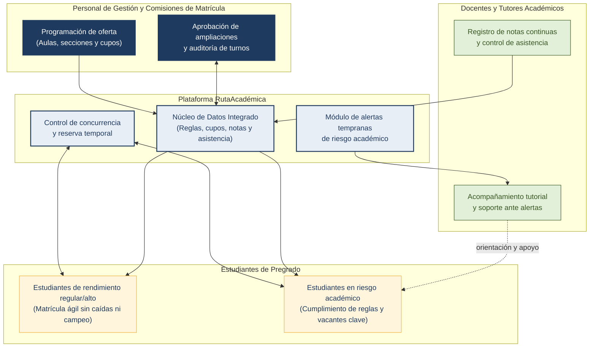

> [Capítulo I: Introducción](../1.md)

# 1.3. Segmentos objetivo

Para el diseño e implementación de **RutaAcadémica**, el startup **AcadémicaTech** ha delimitado su público objetivo a partir del dominio del problema analizado en las secciones 1.1 y 1.2: la gestión de la matrícula por turnos y el seguimiento del rendimiento académico en el entorno universitario.

La identificación de los segmentos objetivo responde a los actores que participan directamente en el ciclo de matrícula y en el proceso de enseñanza-aprendizaje, considerando su nivel de interacción con la plataforma, sus necesidades operativas y su impacto en la reducción del atraso curricular y la deserción universitaria.

Se han definido tres segmentos principales:

1. **Estudiantes universitarios de pregrado** (Usuario primario y beneficiario directo).
2. **Docentes y tutores académicos** (Usuario secundario y de soporte académico).
3. **Personal de gestión académica y comisiones de matrícula** (Usuario institucional y de control operativo).

---

## 1.3.1. Segmento 1: Estudiantes universitarios de pregrado

### Descripción del segmento
Representa el núcleo de usuarios del sistema. Son estudiantes matriculados en programas de pregrado de universidades peruanas —con foco de aplicación inicial en la **Universidad Nacional de Ingeniería (UNI)**— que compiten semestralmente por vacantes en los turnos de matrícula regulados por orden de mérito, planifican su carga semestral bajo reglas estrictas de créditos y prerrequisitos, y requieren un seguimiento transparente de sus calificaciones y asistencia.

Debido a que el rendimiento académico determina el acceso prioritario a los cursos y condiciona la permanencia estudiantil, este segmento se subdivide en dos grupos con dinámicas diferenciadas:

- **Subsegmento 1.1: Estudiantes de rendimiento regular y alto (Turnos tempranos).** Priorizan asegurar secciones con docentes específicos y horarios óptimos. Se ven afectados por la saturación del portal (P1), la pérdida de vacantes en tiempo real (P2) y el "campeo" de cupos por parte de terceros (P3).
- **Subsegmento 1.2: Estudiantes en situación de rezago o riesgo académico (Turnos tardíos).** Estudiantes con asignaturas desaprobadas o promedios ponderados menores a 10.00. Matriculan al final del cronograma, encuentran cupos agotados en cursos clave de su malla curricular y están sujetos a tutoría obligatoria o límites restrictivos de créditos (UNI, 2018). Son los principales beneficiarios del módulo de alertas tempranas (P5).

### Características demográficas y geográficas

| Variable | Criterio / Indicador |
|---|---|
| **Rango de edad** | 17 a 26 años (edad predominante en pregrado universitario). |
| **Género** | Masculino y femenino (a nivel de ingeniería en la UNI: 72.3 % varones y 27.7 % mujeres; a nivel nacional universitario: 49.2 % varones y 50.8 % mujeres) (INEI, 2021; UNI, 2023). |
| **Ubicación geográfica** | Lima Metropolitana (Rímac, San Martín de Porres, Los Olivos, Comas, San Juan de Lurigancho, Cercado de Lima, entre otros distritos adyacentes al campus UNI). |
| **Nivel socioeconómico** | NSE B y C predominantes en universidades públicas como la UNI. |
| **Nivel formativo** | Estudiantes de pregrado desde el 1.º hasta el 10.º ciclo académico. |
| **Ocupación** | Estudiantes a tiempo completo, y estudiantes de ciclos superiores que combinan estudios con prácticas preprofesionales (7.º al 10.º ciclo). |

### Características psicográficas y conductuales

- **Motivaciones:** Graduarse en el tiempo previsto (5 años normativos), evitar cursos desaprobados que retrasen su egreso, lograr horarios compatibles con traslados y prácticas laborales, y matricularse con docentes reconocidos por su didáctica o exigencia formativa.
- **Frustraciones:** Quedar fuera de una sección por caídas del sistema o demoras de segundos al confirmar; descubrir cruces de horario o falta de prerrequisitos durante el turno de matrícula; falta de información oportuna antes de reprobar una asignatura.
- **Hábitos digitales:** Uso intensivo de smartphones para comunicación y consulta; manejo de herramientas colaborativas y hojas de cálculo para planificar horarios previos a la matrícula; alta presencia en comunidades estudiantiles (WhatsApp, Telegram, Discord).

### Información estadística de sustento

1. **Magnitud de la población estudiantil:** A nivel nacional, el sistema universitario peruano cuenta con más de 1,120,000 estudiantes matriculados en pregrado (INEI, 2021; SUNEDU, 2020), de los cuales el 48.2 % se concentra en Lima Metropolitana. En la Universidad Nacional de Ingeniería, la población matriculada semestralmente en sus 11 facultades bordea los 12,600 estudiantes (Oficina Central de Registro y Matrícula [OCRM], UNI, 2023).
2. **Distribución por turnos de mérito:** Conforme al *Reglamento de matrícula de estudiantes de antegrado* de la UNI (2018), la distribución de los estudiantes según su promedio ponderado determina su turno y tope de créditos:
   - **Promedio ponderado ≥ 14.00 (Turno prioritario, hasta 28 créditos):** Representa aproximadamente el 21.4 % del alumnado.
   - **Promedio ponderado de 12.00 a 13.99 (Turno intermedio alto, hasta 26 créditos):** Representa cerca del 33.8 % de los estudiantes.
   - **Promedio ponderado de 10.00 a 11.99 (Turno regular, hasta 24 créditos):** Agrupa al 26.5 % de la población.
   - **Promedio ponderado menor a 10.00 o con cursos en 2.ª / 3.ª repitencia (Turnos tardíos, máximo 15 a 20 créditos):** Agrupa al 18.3 % de los estudiantes, quienes enfrentan riesgo académico directo y requieren acompañamiento tutorial obligatorio.
3. **Impacto del retraso y deserción:** El tiempo promedio de graduación en carreras de ingeniería de universidades públicas supera los 6.8 años debido a trabas de matrícula y cuellos de botella en asignaturas llave (SUNEDU, 2020). Asimismo, la deserción acumulada asciende al 19.3 % a nivel nacional (Dávila Morán et al., 2022).
4. **Acceso a dispositivos:** El 97.4 % de los estudiantes universitarios de ingeniería en Lima cuenta con un smartphone y el 89.1 % posee computadora personal para actividades académicas (INEI, 2021).

---

## 1.3.2. Segmento 2: Docentes y tutores académicos

### Descripción del segmento
Comprende a los catedráticos y profesores tutores de las facultades universitarias. Tienen a su cargo el dictado lectivo, la evaluación continua de los cursos, el registro de asistencia y la labor de tutoría universitaria reglamentada por la Ley Universitaria N.° 30220. Requieren herramientas para registrar calificaciones sin duplicidades y disponer de reportes consolidados que les permitan alertar tempranamente a aquellos estudiantes en peligro de desaprobación o inasistencia reiterada.

### Características demográficas y laborales

| Variable | Criterio / Indicador |
|---|---|
| **Rango de edad** | 32 a 68 años (docentes auxiliares, asociados y principales). |
| **Género** | Masculino y femenino (en ingeniería: ~78 % varones y 22 % mujeres) (UNI, 2023). |
| **Régimen laboral** | Tiempo completo (Dedicación Exclusiva / Tiempo Completo) y tiempo parcial (docentes contratados por horas). |
| **Función docente** | Dictado teórico-práctico y labor de tutoría académica asignada por departamento. |
| **Ubicación** | Lima Metropolitana, asignados a las facultades del campus central de la UNI. |

### Características psicográficas y conductuales

- **Motivaciones:** Fomentar el aprendizaje de los estudiantes, cumplir a tiempo con las actas de notas y syllabus, reducir los índices de desaprobación en sus asignaturas y brindar acompañamiento efectivo a sus alumnos asignados en tutoría.
- **Frustraciones:** Emplear múltiples plataformas no integradas (correos, hojas de cálculo en drive, sistemas heredados rígidos); enterarse del riesgo de un alumno cuando el periodo de evaluaciones ya cerró; carga administrativa pesada para procesar justificaciones de inasistencia o reclamos de notas.
- **Hábitos digitales:** Uso de laptops institucionales y plataformas ofimáticas; interacción moderada con sistemas web universitarios, prefiriendo interfaces intuitivas con mínima fricción operativa.

### Información estadística de sustento

1. **Plana docente:** La Universidad Nacional de Ingeniería cuenta con una plana docente aproximada de 1,320 catedráticos entre profesores nombrados (ordinarios) y contratados (Compendio Estadístico UNI, 2023).
2. **Carga tutorial:** En cumplimiento del artículo 94 de la Ley Universitaria N.° 30220, cada docente con dedicación a tiempo completo tiene asignada una cartera de entre 10 y 25 estudiantes en tutoría académica. En la actualidad, más del 65 % de los docentes manifiesta carecer de un canal digital centralizado que integre las notas y asistencias de sus tutorados en tiempo real, lo que debilita el alcance de la tutoría preventiva (Dávila Morán et al., 2022).
3. **Carga lectiva y secciones:** Cada docente dicta en promedio entre 2 y 4 secciones por semestre académico, manejando grupos de entre 25 y 45 estudiantes por aula de laboratorio o teoría.

---

## 1.3.3. Segmento 3: Personal de gestión académica y comisiones de matrícula

### Descripción del segmento
Abarca a las autoridades y funcionarios operativos responsables de la programación y ejecución del periodo académico en cada facultad y escuela profesional: Directores de Escuela, Jefes de Departamento Académico, miembros de las Comisiones de Matrícula y personal de apoyo administrativo de las Secretarías Académicas.

Tienen la responsabilidad de planificar la oferta curricular (número de secciones, vacantes iniciales, docentes y aulas asignadas), supervisar la ejecución de los turnos de matrícula, atender solicitudes de rectificación y resolver ampliaciones de vacantes en función de la capacidad física instalada y la demanda insatisfecha.

### Características demográficas y organizacionales

| Variable | Criterio / Indicador |
|---|---|
| **Rango de edad** | 35 a 65 años. |
| **Nivel educativo** | Profesionales de ingeniería o afines, con grados de Maestría o Doctorado (autoridades docentes) y personal técnico-administrativo. |
| **Rol institucional** | Decanatos, Direcciones de Escuela Profesional, Jefaturas de Registro y Miembros de Comisión de Matrícula. |
| **Ubicación** | Oficinas administrativas de las 11 facultades de la UNI y la Oficina Central de Registro y Matrícula (OCRM). |

### Características psicográficas y conductuales

- **Motivaciones:** Garantizar un proceso de matrícula ordenado, sin incidentes de sobrecarga ni reclamos masivos; optimizar el uso de aulas y laboratorios; cumplir con las normativas universitarias y los calendarios académicos aprobados por Consejo Universitario.
- **Frustraciones:** Colapso recurrente de los servidores de matrícula; falta de visibilidad en tiempo real de cuántos cupos realmente se necesitan en secciones saturadas; lidiar con el "campeo" de vacantes y solicitudes manuales de ampliación procesadas a destiempo; reportes dispersos que dificultan la auditoría del proceso.
- **Hábitos digitales:** Manejo de sistemas ERP universitarios tradicionales, bases de datos SQL y hojas de cálculo para consolidación manual de información.

### Información estadística de sustento

1. **Unidades de gestión en la UNI:** La universidad opera con 11 facultades, 30 escuelas profesionales y una Oficina Central de Registro y Matrícula (OCRM). Cada facultad conforma semestralmente su Comisión de Matrícula (integrada por autoridades docentes y representantes estudiantiles), lo que conforma un cuerpo de aproximadamente 140 personas involucradas en la toma de decisiones directas de matrícula (UNI, 2018).
2. **Volumen de transacciones y expedientes:** Durante los 3 a 5 días que dura la matrícula regular, cada comisión de matrícula gestiona un promedio de 300 a 600 solicitudes extraordinarias (ampliaciones de vacantes, cruces de horario especiales, cartas de exoneración de créditos y rectificaciones).
3. **Incidencia de incidencias técnicas:** Históricamente, en los periodos de alta concurrencia, las mesas de ayuda de registro académico reciben picos de consultas y quejas atribuibles a saturación de base de datos y falta de concurrencia aislada (P1 y P2).

---

## 1.3.4. Matriz comparativa de segmentos objetivo

La siguiente tabla resume la relación entre cada segmento, su representatividad cuantitativa, sus problemas críticos (asociados a P1-P5) y la propuesta de valor ofrecida por **RutaAcadémica**:

| Segmento | Rol en la plataforma | Volumen estimado (Contexto UNI) | Problemas críticos asociados | Propuesta de valor de RutaAcadémica |
|---|---|---|---|---|
| **Estudiantes de pregrado (Rendimiento regular y alto)** | Usuario primario (transaccional) | ~8,200 estudiantes (~65 %) | **P1, P2, P3, P4** (Saturación, pérdida de vacantes, campeo y cruces de horario) | Consulta ágil y de alta concurrencia; confirmación segura con reserva temporal; sugerencia de alternativas compatibles sin rehacer el horario. |
| **Estudiantes de pregrado (Riesgo académico / rezago)** | Usuario primario (prioritario en soporte) | ~2,300 estudiantes (~18 %) | **P2, P4, P5** (Vacantes agotadas en cursos clave, límites de créditos y falta de apoyo oportuno) | Asignación controlada bajo reglas de reglamento; conexión directa con tutores; alertas tempranas de desempeño y asistencia. |
| **Docentes y tutores académicos** | Usuario secundario (evaluador y tutor) | ~1,320 docentes | **P5** (Seguimiento desarticulado de notas, asistencias y tutorías) | Registro centralizado y ágil de calificaciones; panel con alertas automáticas de estudiantes en riesgo para intervención oportuna. |
| **Personal de gestión y comisiones de matrícula** | Usuario institucional (administrador y decisor) | ~140 funcionarios y miembros de comisión | **P1, P2, P3** (Colapso de consultas, gestión reactiva de vacantes y campeo no regulado) | Auditoría de turnos y cupos en tiempo real; gestión ordenada y justificada de ampliaciones de vacantes; métricas de demanda insatisfecha. |

---

## 1.3.5. Interacción entre segmentos en el ecosistema RutaAcadémica

La Figura 5 ilustra cómo convergen los tres segmentos dentro de la plataforma **RutaAcadémica**, articulando la programación de recursos, la ejecución de la matrícula y el seguimiento continuo del estudiante:

<em>Figura 5. Ecosistema de interacción entre los segmentos objetivo en RutaAcadémica. Elaboración propia.</em>

---

## Referencias

Dávila Morán, R. C., Agüero Corzo, E. C., Portillo Rios, H., & Quimbita Chiluisa, O. R. (2022). Deserción universitaria de los estudiantes de una universidad peruana. *Revista Universidad y Sociedad, 14*(2), 421–427. https://rus.ucf.edu.cu/index.php/rus/article/download/2722/2680/5329

Instituto Nacional de Estadística e Informática. (2021). *Perú: Estructura del mercado universitario y características de la población estudiantil*. INEI.

Ley Universitaria N.° 30220. (2014, 9 de julio). Congreso de la República del Perú. *Diario Oficial El Peruano*.

Superintendencia Nacional de Educación Superior Universitaria. (2020). *Informe bienal sobre la realidad universitaria en el Perú*. SUNEDU.

Universidad Nacional de Ingeniería. (2018). *Reglamento de matrícula de estudiantes de antegrado* (Resolución Rectoral N.° 0275). https://fc.uni.edu.pe/wp-content/uploads/2021/06/reglamentodematriculajunio.pdf

Universidad Nacional de Ingeniería. (2023). *Compendio estadístico universitario 2022-2023*. Oficina Central de Registro y Matrícula (OCRM), UNI.

---

[⬅️ Anterior](../1.2/1.2.2/1.2.2.md) | [🏠 Home](../../README.md)
