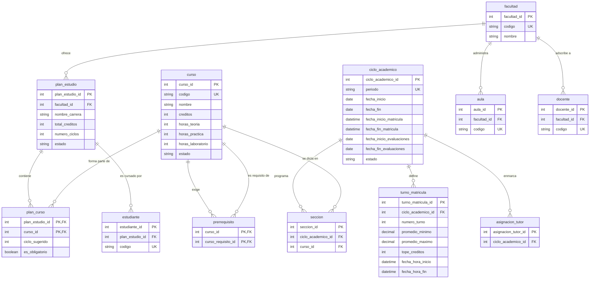

> [Capítulo III: Diseño de base de datos](../../../3.md) › [3.3. Enfoque relacional](../../3.3.md) › [3.3.1. Diagrama entidad-relación lógico](../3.3.1.md)

# 3.3.1.1. Vista detallada: Módulo 1 (EUSTAQUIO) — Estructura académica

El siguiente diagrama entidad-relación lógico detalla las entidades, atributos y relaciones correspondientes al **Módulo 1: Estructura académica**, bajo la responsabilidad del integrante **Eustaquio**.

> *Nota:* Las entidades sombreadas (aula, docente, estudiante, seccion, asignacion_tutor) pertenecen a otros módulos y se muestran aquí solo para indicar los vínculos de frontera.

<em>Figura 7. Diagrama entidad-relación lógico del módulo 1 (estructura académica). Elaboración propia.</em>

---

[⬅️ Vista general (3.3.1)](../3.3.1.md) | [Siguiente módulo ➡️](../3.3.1.2/3.3.1.2.md)
