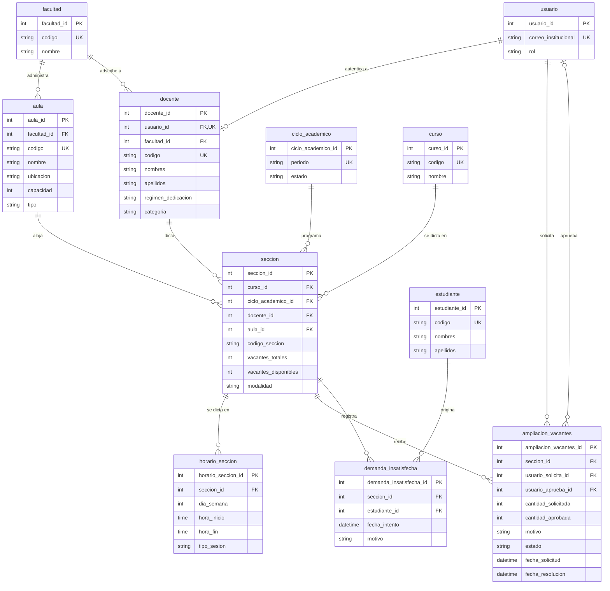

> [Capítulo III: Diseño de base de datos](../../../3.md) › [3.3. Enfoque relacional](../../3.3.md) › [3.3.1. Diagrama entidad-relación lógico](../3.3.1.md)

# 3.3.1.2. Vista detallada: Módulo 2 (GOMEZ) — Docentes, secciones y aulas

El siguiente diagrama entidad-relación lógico detalla las entidades, atributos y relaciones correspondientes al **Módulo 2: Docentes, secciones y aulas**, bajo la responsabilidad del integrante **Gomez**.

> [!NOTE]
> - Las entidades propias de este módulo son: `docente`, `aula`, `seccion`, `horario_seccion`, `ampliacion_vacantes` y `demanda_insatisfecha`.
> - Las entidades de frontera (`facultad`, `ciclo_academico`, `curso`, `usuario`, `estudiante`) se incluyen con sus atributos identificadores para ilustrar las dependencias de programación académica, autenticación y registro de demanda insatisfecha.

<em>Figura 8. Diagrama entidad-relación lógico del módulo 2 (docentes, secciones y aulas). Elaboración propia.</em>

---

[⬅️ Módulo anterior](../3.3.1.1/3.3.1.1.md) | [Vista general (3.3.1)](../3.3.1.md) | [Siguiente módulo ➡️](../3.3.1.3/3.3.1.3.md)
