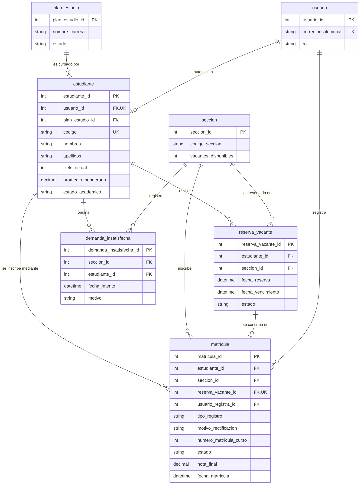

> [Capítulo III: Diseño de base de datos](../../../3.md) › [3.3. Enfoque relacional](../../3.3.md) › [3.3.1. Diagrama entidad-relación lógico](../3.3.1.md)

# 3.3.1.3. Vista detallada: Módulo 3 (MUÑOZ) — Estudiantes y matrícula

El siguiente diagrama entidad-relación lógico detalla las entidades, atributos y relaciones correspondientes al **Módulo 3: Estudiantes y matrícula**, bajo la responsabilidad del integrante **Muñoz**.

> [!NOTE]
> - Las entidades propias de este módulo son: `estudiante`, `reserva_vacante` y `matricula`.
> - Las entidades de frontera (`plan_estudio`, `usuario`, `seccion`, `demanda_insatisfecha`) se incluyen con sus atributos clave para ilustrar la filiación de carrera, el mecanismo de autenticación y auditoría de matrícula, la asignación de vacantes y el registro de demanda insatisfecha.
> - El seguimiento de evaluaciones, calificaciones, asistencia y riesgo académico generado a partir de cada matrícula se detalla exhaustivamente en el **Módulo 4** (sección 3.3.1.4).

<em>Figura 9. Diagrama entidad-relación lógico del módulo 3 (estudiantes y matrícula). Elaboración propia.</em>

---

[⬅️ Módulo anterior](../3.3.1.2/3.3.1.2.md) | [Vista general (3.3.1)](../3.3.1.md) | [Siguiente módulo ➡️](../3.3.1.4/3.3.1.4.md)
