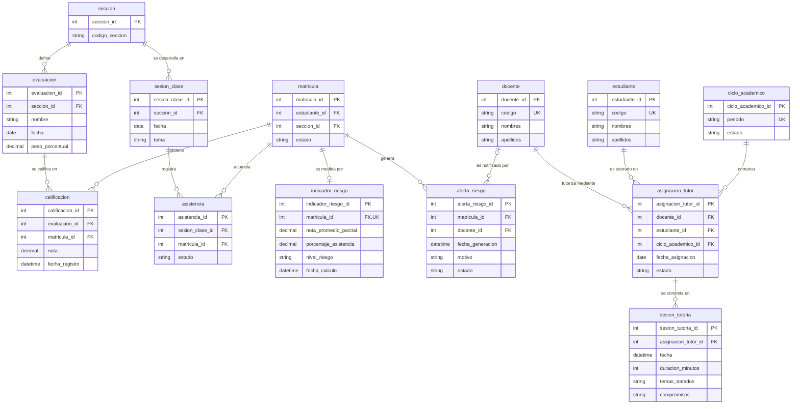

> [Capítulo III: Diseño de base de datos](../../../3.md) › [3.3. Enfoque relacional](../../3.3.md) › [3.3.1. Diagrama entidad-relación lógico](../3.3.1.md)

# 3.3.1.4. Vista detallada: Módulo 4 (PAUCAR) — Evaluación, asistencia y riesgo

El siguiente diagrama entidad-relación lógico detalla las entidades, atributos y relaciones correspondientes al **Módulo 4: Evaluación, asistencia y riesgo**, bajo la responsabilidad del integrante **Paucar**.

> [!NOTE]
> - Las entidades propias de este módulo son: `evaluacion`, `calificacion`, `sesion_clase`, `asistencia`, `indicador_riesgo`, `alerta_riesgo`, `asignacion_tutor` y `sesion_tutoria`.
> - Las entidades de frontera (`seccion`, `matricula`, `docente`, `estudiante`, `ciclo_academico`) se incluyen con sus atributos identificadores para ilustrar de dónde proceden las sesiones y matrículas a evaluar, y quiénes intervienen en el programa de tutoría académica.

<em>Figura 10. Diagrama entidad-relación lógico del módulo 4 (evaluación, asistencia y riesgo). Elaboración propia.</em>

---

[⬅️ Módulo anterior](../3.3.1.3/3.3.1.3.md) | [Vista general (3.3.1)](../3.3.1.md) | [Siguiente módulo ➡️](../3.3.1.5/3.3.1.5.md)
