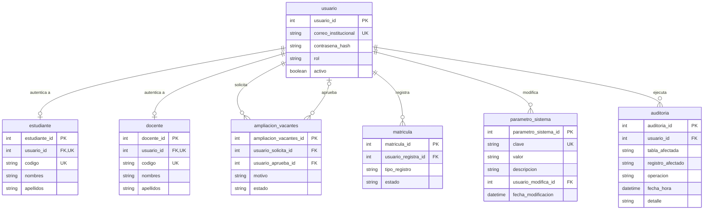

> [Capítulo III: Diseño de base de datos](../../../3.md) › [3.3. Enfoque relacional](../../3.3.md) › [3.3.1. Diagrama entidad-relación lógico](../3.3.1.md)

# 3.3.1.5. Vista detallada: Módulo Transversal — Seguridad, configuración y auditoría

El siguiente diagrama entidad-relación lógico detalla las entidades, atributos y relaciones correspondientes al **Módulo Transversal (Seguridad, configuración y auditoría)**, coordinado por el equipo.

> [!NOTE]
> - Las entidades propias de este módulo son: `usuario`, `parametro_sistema` y `auditoria`.
> - `parametro_sistema` almacena parámetros globales de configuración del sistema (como topes de créditos por defecto, penalidades y tolerancias), registrando en `usuario_modifica_id` al administrador responsable del cambio.
> - `auditoria` registra de manera centralizada la traza de eventos (`INSERT`, `UPDATE`, `DELETE`) ejecutados por cualquier `usuario` sobre las tablas del sistema.
> - Las entidades de frontera (`estudiante`, `docente`, `ampliacion_vacantes`, `matricula`) ilustran cómo los usuarios del sistema se vinculan por rol para la autenticación y cómo se audita la autoría de trámites y matrículas.

<em>Figura 11. Diagrama entidad-relación lógico del módulo transversal. Elaboración propia.</em>

---

[⬅️ Módulo anterior](../3.3.1.4/3.3.1.4.md) | [Vista general (3.3.1)](../3.3.1.md)
