> [Capítulo III: Diseño de base de datos](../../3.md) › [3.3. Enfoque relacional](../3.3.md)

# 3.3.1. Diagrama entidad-relación lógico

El diagrama entidad-relación lógico muestra las entidades, sus atributos y las relaciones entre ellas, sin depender de un gestor de base de datos. Sirve como vista común para el equipo de desarrollo y para los usuarios.

Dado que el modelo tiene 27 entidades, se presenta en dos niveles: una **vista general** con todas las entidades y relaciones, y una **vista detallada por módulo** con los atributos de cada una de las tablas.

**Cómo leer el diagrama**

| Símbolo | Significado |
|---|---|
| `\|\|` | Exactamente uno |
| `\|o` / `o\|` | Cero o uno |
| `o{` | Cero o varios |
| **PK** / **FK** / **UK** | Clave primaria / foránea / valor único |

El diagrama entidad-relación utiliza las siguientes representaciones compactas de tipos de datos:

| Representación del diagrama | Tipo |
|---|---|
| `int` | `INT` |
| `string` | `VARCHAR(n)` |
| `decimal` | `DECIMAL(p,s)` |
| `boolean` | `BIT` |
| `date` | `DATE` |
| `datetime` | `DATETIME` |
| `hora_inicio` / `hora_fin` | `TIME` |

## Vista general

```mermaid
erDiagram
    facultad {
        int facultad_id PK
    }
    plan_estudio {
        int plan_estudio_id PK
    }
    curso {
        int curso_id PK
    }
    plan_curso {
        int plan_estudio_id PK, FK
        int curso_id PK, FK
    }
    prerrequisito {
        int curso_id PK, FK
        int curso_requisito_id PK, FK
    }
    ciclo_academico {
        int ciclo_academico_id PK
    }
    turno_matricula {
        int turno_matricula_id PK
    }
    usuario {
        int usuario_id PK
    }
    docente {
        int docente_id PK
    }
    aula {
        int aula_id PK
    }
    seccion {
        int seccion_id PK
    }
    horario_seccion {
        int horario_seccion_id PK
    }
    ampliacion_vacantes {
        int ampliacion_vacantes_id PK
    }
    demanda_insatisfecha {
        int demanda_insatisfecha_id PK
    }
    estudiante {
        int estudiante_id PK
    }
    reserva_vacante {
        int reserva_vacante_id PK
    }
    matricula {
        int matricula_id PK
    }
    evaluacion {
        int evaluacion_id PK
    }
    calificacion {
        int calificacion_id PK
    }
    sesion_clase {
        int sesion_clase_id PK
    }
    asistencia {
        int asistencia_id PK
    }
    indicador_riesgo {
        int indicador_riesgo_id PK
    }
    alerta_riesgo {
        int alerta_riesgo_id PK
    }
    asignacion_tutor {
        int asignacion_tutor_id PK
    }
    sesion_tutoria {
        int sesion_tutoria_id PK
    }
    parametro_sistema {
        int parametro_sistema_id PK
    }
    auditoria {
        int auditoria_id PK
    }
    facultad ||--o{ plan_estudio : "ofrece"
    facultad ||--o{ aula : "administra"
    facultad ||--o{ docente : "adscribe a"
    plan_estudio ||--o{ plan_curso : "contiene"
    curso ||--o{ plan_curso : "forma parte de"
    curso ||--o{ prerrequisito : "exige"
    curso ||--o{ prerrequisito : "es requisito de"
    plan_estudio ||--o{ estudiante : "es cursado por"
    ciclo_academico ||--o{ turno_matricula : "define"
    ciclo_academico ||--o{ seccion : "programa"
    ciclo_academico ||--o{ asignacion_tutor : "enmarca"
    usuario ||--o| estudiante : "autentica a"
    usuario ||--o| docente : "autentica a"
    curso ||--o{ seccion : "se dicta en"
    docente ||--o{ seccion : "dicta"
    aula ||--o{ seccion : "aloja"
    seccion ||--o{ horario_seccion : "se dicta en"
    seccion ||--o{ ampliacion_vacantes : "recibe"
    usuario ||--o{ ampliacion_vacantes : "solicita"
    usuario |o--o{ ampliacion_vacantes : "aprueba"
    seccion ||--o{ demanda_insatisfecha : "registra"
    estudiante ||--o{ demanda_insatisfecha : "origina"
    estudiante ||--o{ reserva_vacante : "realiza"
    seccion ||--o{ reserva_vacante : "es reservada en"
    estudiante ||--o{ matricula : "se inscribe mediante"
    seccion ||--o{ matricula : "inscribe"
    reserva_vacante ||--o| matricula : "se confirma en"
    usuario ||--o{ matricula : "registra"
    seccion ||--o{ evaluacion : "define"
    evaluacion ||--o{ calificacion : "se califica en"
    matricula ||--o{ calificacion : "obtiene"
    seccion ||--o{ sesion_clase : "se desarrolla en"
    sesion_clase ||--o{ asistencia : "registra"
    matricula ||--o{ asistencia : "acumula"
    matricula ||--o| indicador_riesgo : "es medida por"
    matricula ||--o{ alerta_riesgo : "genera"
    docente |o--o{ alerta_riesgo : "es notificado por"
    docente ||--o{ asignacion_tutor : "tutoriza mediante"
    estudiante ||--o{ asignacion_tutor : "es tutorado en"
    asignacion_tutor ||--o{ sesion_tutoria : "se concreta en"
    usuario ||--o{ parametro_sistema : "modifica"
    usuario ||--o{ auditoria : "ejecuta"
```

<em>Figura 6. Diagrama entidad-relación lógico, vista general. Elaboración propia.</em>

## Vistas detalladas por módulo

A continuación se presentan los diagramas lógicos detallados con todos los atributos de cada módulo:

- [3.3.1.1. Módulo 1 (EUSTAQUIO) — Estructura académica](./3.3.1.1/3.3.1.1.md)
- [3.3.1.2. Módulo 2 (GOMEZ) — Docentes, secciones y aulas](./3.3.1.2/3.3.1.2.md)
- [3.3.1.3. Módulo 3 (MUÑOZ) — Estudiantes y matrícula](./3.3.1.3/3.3.1.3.md)
- [3.3.1.4. Módulo 4 (PAUCAR) — Evaluación, asistencia y riesgo](./3.3.1.4/3.3.1.4.md)
- [3.3.1.5. Módulo Transversal — Seguridad, configuración y auditoría](./3.3.1.5/3.3.1.5.md)

## Observaciones

- El diagrama es **lógico**: los tipos de dato y las restricciones propias de un gestor (índices, secuencias, motores) se definen en el diagrama entidad-relación físico de la sección 4.2.1.
- Las vistas por módulo muestran cada relación en el módulo que contiene a alguna de sus entidades, por lo que una relación entre módulos aparece en ambos.
- El archivo fuente de los diagramas está escrito en Mermaid dentro de estos documentos, por lo que se versiona con el repositorio y se visualiza directamente en GitHub.

---

[⬅️ Anterior](../3.3.md) | [🏠 Home](../../../README.md)
