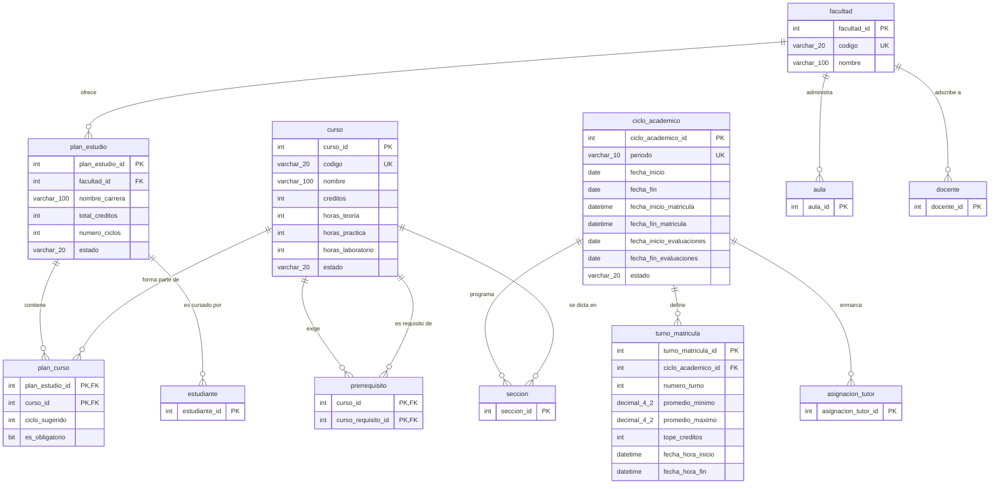

> [Capítulo IV: Implementación de base de datos](../../../4.md) › [4.2. Diagramas de datos](../../4.2.md) › [4.2.1. Diagrama entidad-relación físico](../4.2.1.md)

# 4.2.1.1. Vista física detallada: Módulo 1 (EUSTAQUIO) — Estructura académica

El siguiente diagrama entidad-relación físico detalla las tablas, tipos de datos físicos en **Microsoft SQL Server 2022**, claves primarias, claves foráneas y restricciones del **Módulo 1: Estructura académica**, bajo la responsabilidad de **Eustaquio**.

<em>Figura 15. Diagrama físico del Módulo 1 (Estructura académica) en SQL Server. Elaboración propia.</em>

---

[⬅️ Vista general física (4.2.1)](../4.2.1.md) | [Siguiente módulo ➡️](../4.2.1.2/4.2.1.2.md)

