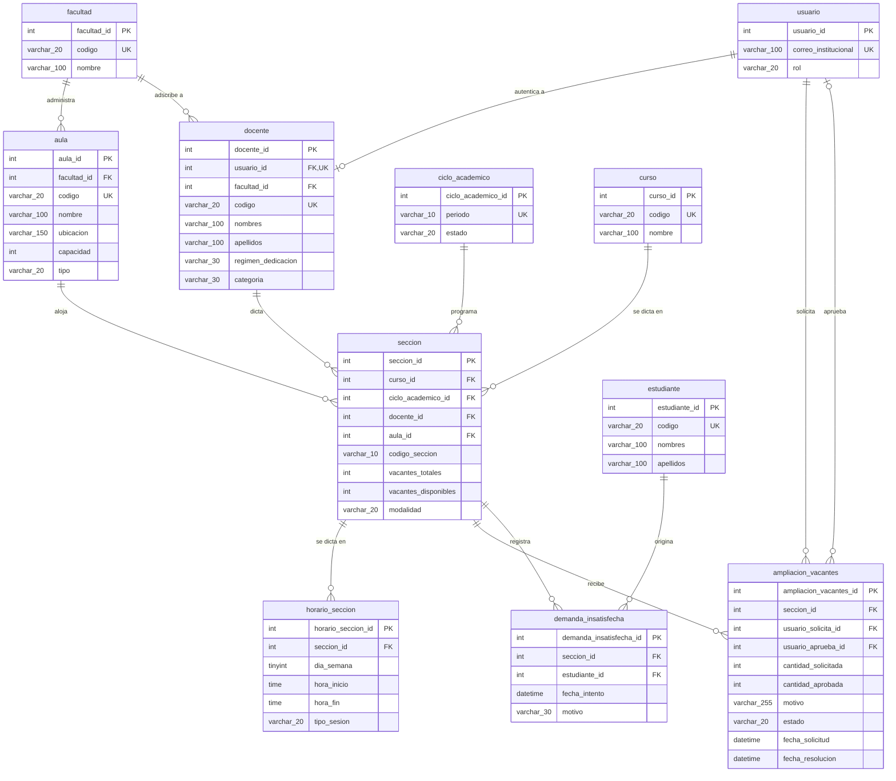

> [Capítulo IV: Implementación de base de datos](../../../4.md) › [4.2. Diagramas de datos](../../4.2.md) › [4.2.1. Diagrama entidad-relación físico](../4.2.1.md)

# 4.2.1.2. Vista física detallada: Módulo 2 (GOMEZ) — Docentes, secciones y aulas

El siguiente diagrama entidad-relación físico detalla las tablas, tipos de datos físicos en **Microsoft SQL Server 2022**, claves primarias, claves foráneas y restricciones del **Módulo 2: Docentes, secciones y aulas**, bajo la responsabilidad de **Gomez**.

> [!NOTE]
> - Las tablas propias de este módulo cuentan con su estructura física completa: tipos nativos T-SQL (`int`, `varchar(n)`, `tinyint`, `time`, `datetime`), PKs, FKs y restricciones de unicidad.
> - Las tablas de frontera (`facultad`, `ciclo_academico`, `curso`, `usuario`, `estudiante`) incluyen sus atributos principales para representar limpiamente las relaciones sin tablas vacías ni conexiones huérfanas.

<em>Figura 16. Diagrama físico del Módulo 2 (Docentes, secciones y aulas) en SQL Server. Elaboración propia.</em>

---

[⬅️ Módulo anterior](../4.2.1.1/4.2.1.1.md) | [Vista general física (4.2.1)](../4.2.1.md) | [Siguiente módulo ➡️](../4.2.1.3/4.2.1.3.md)
