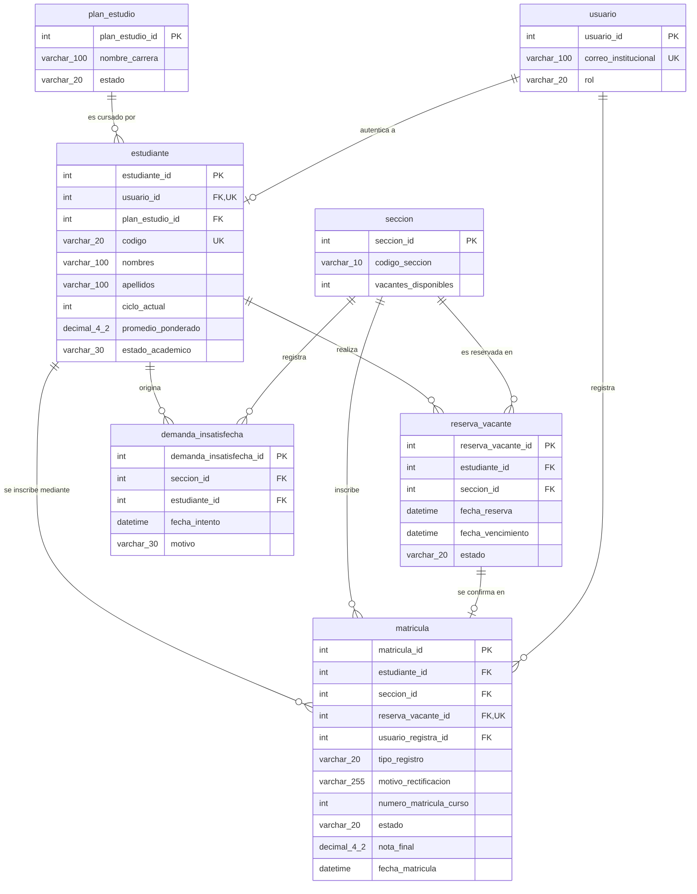

> [Capítulo IV: Implementación de base de datos](../../../4.md) › [4.2. Diagramas de datos](../../4.2.md) › [4.2.1. Diagrama entidad-relación físico](../4.2.1.md)

# 4.2.1.3. Vista física detallada: Módulo 3 (MUÑOZ) — Estudiantes y matrícula

El siguiente diagrama entidad-relación físico detalla las tablas, tipos de datos físicos en **Microsoft SQL Server 2022**, claves primarias, claves foráneas y restricciones del **Módulo 3: Estudiantes y matrícula**, bajo la responsabilidad de **Muñoz**.

> [!NOTE]
> - Las tablas propias de este módulo cuentan con su estructura física completa: tipos nativos T-SQL (`int`, `varchar(n)`, `decimal(p,s)`, `datetime`), PKs, FKs y restricciones de unicidad (`reserva_vacante_id UK` en `matricula`).
> - Las tablas de frontera (`plan_estudio`, `usuario`, `seccion`, `demanda_insatisfecha`) incluyen sus columnas clave para ilustrar la integración del proceso de matrícula sin tablas vacías ni relaciones desconectadas.
> - La evaluación de notas, asistencias, indicadores de riesgo y tutoría derivados de cada matrícula se detalla físicamente en el **Módulo 4** (sección 4.2.1.4).

<em>Figura 17. Diagrama físico del Módulo 3 (Estudiantes y matrícula) en SQL Server. Elaboración propia.</em>

---

[⬅️ Módulo anterior](../4.2.1.2/4.2.1.2.md) | [Vista general física (4.2.1)](../4.2.1.md) | [Siguiente módulo ➡️](../4.2.1.4/4.2.1.4.md)
