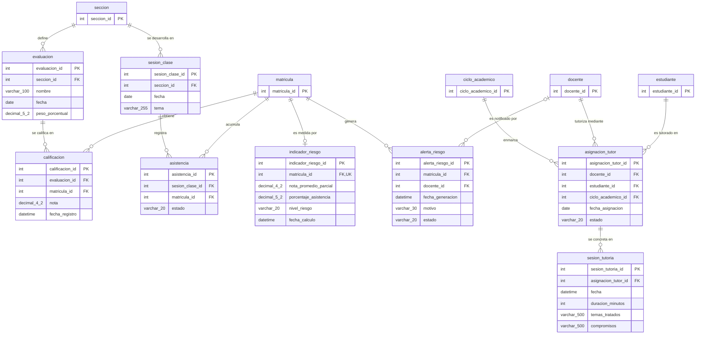

> [Capítulo IV: Implementación de base de datos](../../../4.md) › [4.2. Diagramas de datos](../../4.2.md) › [4.2.1. Diagrama entidad-relación físico](../4.2.1.md)

# 4.2.1.4. Vista física detallada: Módulo 4 (PAUCAR) — Evaluación, asistencia y riesgo

El siguiente diagrama entidad-relación físico detalla las tablas, tipos de datos físicos en **Microsoft SQL Server 2022**, claves primarias, claves foráneas y restricciones del **Módulo 4: Evaluación, asistencia y riesgo**, bajo la responsabilidad de **Paucar**.

<em>Figura 18. Diagrama físico del Módulo 4 (Evaluación, asistencia y riesgo) en SQL Server. Elaboración propia.</em>

---

[⬅️ Módulo anterior](../4.2.1.3/4.2.1.3.md) | [Vista general física (4.2.1)](../4.2.1.md) | [Siguiente módulo ➡️](../4.2.1.5/4.2.1.5.md)

