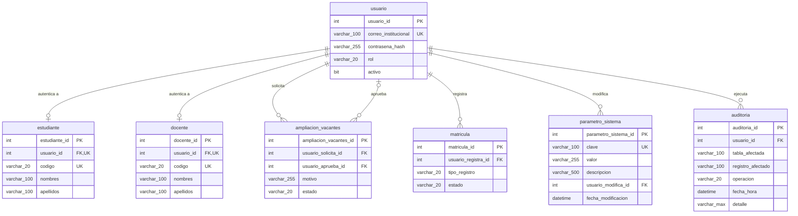

> [Capítulo IV: Implementación de base de datos](../../../4.md) › [4.2. Diagramas de datos](../../4.2.md) › [4.2.1. Diagrama entidad-relación físico](../4.2.1.md)

# 4.2.1.5. Vista física detallada: Módulo Transversal — Seguridad, configuración y auditoría

El siguiente diagrama entidad-relación físico detalla las tablas, tipos de datos físicos en **Microsoft SQL Server 2022**, claves primarias, claves foráneas y restricciones del **Módulo Transversal (Seguridad, configuración y auditoría)**, coordinado por el equipo.

> [!NOTE]
> - Las tablas propias de este módulo cuentan con su estructura física completa: tipos nativos T-SQL (`int`, `varchar(n)`, `varchar(max)`, `bit`, `datetime`), PKs, FKs y restricciones de unicidad.
> - `parametro_sistema` almacena la configuración dinámica del sistema y registra en `usuario_modifica_id` al administrador que aplicó el cambio.
> - `auditoria` registra la trazabilidad global de transacciones (`INSERT`, `UPDATE`, `DELETE`) de cualquier usuario sobre los registros del sistema.
> - Las tablas de frontera (`estudiante`, `docente`, `ampliacion_vacantes`, `matricula`) se presentan con sus atributos clave para ilustrar la autenticación de usuarios y la trazabilidad de operaciones.

<em>Figura 19. Diagrama físico del Módulo Transversal en SQL Server. Elaboración propia.</em>

---

[⬅️ Módulo anterior](../4.2.1.4/4.2.1.4.md) | [Vista general física (4.2.1)](../4.2.1.md)
