> [Capítulo IV: Implementación de base de datos](../../4.md) › [4.2. Diagramas de datos](../4.2.md)

# 4.2.1. Diagrama entidad-relación físico

El diagrama entidad-relación físico representa la estructura real de la base de datos `RutaAcademica` implementada en **Microsoft SQL Server 2022**. A diferencia del diagrama lógico (sección 3.3.1), el diagrama físico incluye los tipos de datos nativos del gestor, la sintaxis exacta de las restricciones, los índices y la notación de las claves primarias y foráneas tal como se definen en el DDL de la sección 4.3.1.

**Convención del diagrama físico**

| Símbolo | Significado |
|---|---|
| `PK` | Clave primaria (`PRIMARY KEY`) |
| `FK` | Clave foránea (`FOREIGN KEY … REFERENCES`) |
| `UK` | Restricción de unicidad (`UNIQUE`) |
| `\|\|` | Exactamente uno (extremo obligatorio) |
| `o{` | Cero o varios |
| `\|o` | Cero o uno |

> *Nota:* Todas las columnas sin valor por defecto o nulo explícito son `NOT NULL`, conforme al DDL de la sección 4.3.1.

## Vista general — todas las tablas

```mermaid
erDiagram
    facultad {
        int facultad_id PK
        varchar_20 codigo UK
        varchar_100 nombre
    }
    plan_estudio {
        int plan_estudio_id PK
        int facultad_id FK
        varchar_100 nombre_carrera
        int total_creditos
        int numero_ciclos
        varchar_20 estado
    }
    curso {
        int curso_id PK
        varchar_20 codigo UK
        varchar_100 nombre
        int creditos
        int horas_teoria
        int horas_practica
        int horas_laboratorio
        varchar_20 estado
    }
    plan_curso {
        int plan_estudio_id PK, FK
        int curso_id PK, FK
        int ciclo_sugerido
        bit es_obligatorio
    }
    prerrequisito {
        int curso_id PK, FK
        int curso_requisito_id PK, FK
    }
    ciclo_academico {
        int ciclo_academico_id PK
        varchar_10 periodo UK
        date fecha_inicio
        date fecha_fin
        datetime fecha_inicio_matricula
        datetime fecha_fin_matricula
        date fecha_inicio_evaluaciones
        date fecha_fin_evaluaciones
        varchar_20 estado
    }
    turno_matricula {
        int turno_matricula_id PK
        int ciclo_academico_id FK
        int numero_turno
        decimal_4_2 promedio_minimo
        decimal_4_2 promedio_maximo
        int tope_creditos
        datetime fecha_hora_inicio
        datetime fecha_hora_fin
    }
    usuario {
        int usuario_id PK
        varchar_100 correo_institucional UK
        varchar_255 contrasena_hash
        varchar_20 rol
        bit activo
    }
    docente {
        int docente_id PK
        int usuario_id FK, UK
        int facultad_id FK
        varchar_20 codigo UK
        varchar_100 nombres
        varchar_100 apellidos
        varchar_30 regimen_dedicacion
        varchar_30 categoria
    }
    aula {
        int aula_id PK
        int facultad_id FK
        varchar_20 codigo UK
        varchar_100 nombre
        varchar_150 ubicacion
        int capacidad
        varchar_20 tipo
    }
    seccion {
        int seccion_id PK
        int curso_id FK
        int ciclo_academico_id FK
        int docente_id FK
        int aula_id FK
        varchar_10 codigo_seccion
        int vacantes_totales
        int vacantes_disponibles
        varchar_20 modalidad
    }
    horario_seccion {
        int horario_seccion_id PK
        int seccion_id FK
        tinyint dia_semana
        time hora_inicio
        time hora_fin
        varchar_20 tipo_sesion
    }
    ampliacion_vacantes {
        int ampliacion_vacantes_id PK
        int seccion_id FK
        int usuario_solicita_id FK
        int usuario_aprueba_id FK
        int cantidad_solicitada
        int cantidad_aprobada
        varchar_255 motivo
        varchar_20 estado
        datetime fecha_solicitud
        datetime fecha_resolucion
    }
    demanda_insatisfecha {
        int demanda_insatisfecha_id PK
        int seccion_id FK
        int estudiante_id FK
        datetime fecha_intento
        varchar_30 motivo
    }
    estudiante {
        int estudiante_id PK
        int usuario_id FK, UK
        int plan_estudio_id FK
        varchar_20 codigo UK
        varchar_100 nombres
        varchar_100 apellidos
        int ciclo_actual
        decimal_4_2 promedio_ponderado
        varchar_30 estado_academico
    }
    reserva_vacante {
        int reserva_vacante_id PK
        int estudiante_id FK
        int seccion_id FK
        datetime fecha_reserva
        datetime fecha_vencimiento
        varchar_20 estado
    }
    matricula {
        int matricula_id PK
        int estudiante_id FK
        int seccion_id FK
        int reserva_vacante_id FK, UK
        int usuario_registra_id FK
        varchar_20 tipo_registro
        varchar_255 motivo_rectificacion
        int numero_matricula_curso
        varchar_20 estado
        decimal_4_2 nota_final
        datetime fecha_matricula
    }
    evaluacion {
        int evaluacion_id PK
        int seccion_id FK
        varchar_100 nombre
        date fecha
        decimal_5_2 peso_porcentual
    }
    calificacion {
        int calificacion_id PK
        int evaluacion_id FK
        int matricula_id FK
        decimal_4_2 nota
        datetime fecha_registro
    }
    sesion_clase {
        int sesion_clase_id PK
        int seccion_id FK
        date fecha
        varchar_255 tema
    }
    asistencia {
        int asistencia_id PK
        int sesion_clase_id FK
        int matricula_id FK
        varchar_20 estado
    }
    indicador_riesgo {
        int indicador_riesgo_id PK
        int matricula_id FK, UK
        decimal_4_2 nota_promedio_parcial
        decimal_5_2 porcentaje_asistencia
        varchar_20 nivel_riesgo
        datetime fecha_calculo
    }
    alerta_riesgo {
        int alerta_riesgo_id PK
        int matricula_id FK
        int docente_id FK
        datetime fecha_generacion
        varchar_30 motivo
        varchar_20 estado
    }
    asignacion_tutor {
        int asignacion_tutor_id PK
        int docente_id FK
        int estudiante_id FK
        int ciclo_academico_id FK
        date fecha_asignacion
        varchar_20 estado
    }
    sesion_tutoria {
        int sesion_tutoria_id PK
        int asignacion_tutor_id FK
        datetime fecha
        int duracion_minutos
        varchar_500 temas_tratados
        varchar_500 compromisos
    }
    parametro_sistema {
        int parametro_sistema_id PK
        varchar_100 clave UK
        varchar_255 valor
        varchar_500 descripcion
        int usuario_modifica_id FK
        datetime fecha_modificacion
    }
    auditoria {
        int auditoria_id PK
        int usuario_id FK
        varchar_100 tabla_afectada
        varchar_100 registro_afectado
        varchar_20 operacion
        datetime fecha_hora
        varchar_max detalle
    }

    facultad ||--o{ plan_estudio : "ofrece"
    facultad ||--o{ aula : "administra"
    facultad ||--o{ docente : "adscribe a"
    plan_estudio ||--o{ plan_curso : "contiene"
    curso ||--o{ plan_curso : "forma parte de"
    curso ||--o{ prerrequisito : "exige"
    curso ||--o{ prerrequisito : "es requisito de"
    plan_estudio ||--o{ estudiante : "es cursado por"
    ciclo_academico ||--o{ turno_matricula : "define"
    ciclo_academico ||--o{ seccion : "programa"
    ciclo_academico ||--o{ asignacion_tutor : "enmarca"
    usuario ||--o| estudiante : "autentica a"
    usuario ||--o| docente : "autentica a"
    curso ||--o{ seccion : "se dicta en"
    docente ||--o{ seccion : "dicta"
    aula ||--o{ seccion : "aloja"
    seccion ||--o{ horario_seccion : "se dicta en"
    seccion ||--o{ ampliacion_vacantes : "recibe"
    usuario ||--o{ ampliacion_vacantes : "solicita"
    usuario |o--o{ ampliacion_vacantes : "aprueba"
    seccion ||--o{ demanda_insatisfecha : "registra"
    estudiante ||--o{ demanda_insatisfecha : "origina"
    estudiante ||--o{ reserva_vacante : "realiza"
    seccion ||--o{ reserva_vacante : "es reservada en"
    estudiante ||--o{ matricula : "se inscribe mediante"
    seccion ||--o{ matricula : "inscribe"
    reserva_vacante ||--o| matricula : "se confirma en"
    usuario ||--o{ matricula : "registra"
    seccion ||--o{ evaluacion : "define"
    evaluacion ||--o{ calificacion : "se califica en"
    matricula ||--o{ calificacion : "obtiene"
    seccion ||--o{ sesion_clase : "se desarrolla en"
    sesion_clase ||--o{ asistencia : "registra"
    matricula ||--o{ asistencia : "acumula"
    matricula ||--o| indicador_riesgo : "es medida por"
    matricula ||--o{ alerta_riesgo : "genera"
    docente |o--o{ alerta_riesgo : "es notificado por"
    docente ||--o{ asignacion_tutor : "tutoriza mediante"
    estudiante ||--o{ asignacion_tutor : "es tutorado en"
    asignacion_tutor ||--o{ sesion_tutoria : "se concreta en"
    usuario ||--o{ parametro_sistema : "modifica"
    usuario ||--o{ auditoria : "ejecuta"
```

<em>Figura 12. Diagrama entidad-relación físico de RutaAcadémica (vista general). Elaboración propia.</em>

## Vistas físicas detalladas por módulo

A continuación se presentan los diagramas físicos detallados con todos los atributos y relaciones por cada módulo:

- [4.2.1.1. Módulo 1 (EUSTAQUIO) — Estructura académica](./4.2.1.1/4.2.1.1.md)
- [4.2.1.2. Módulo 2 (GOMEZ) — Docentes, secciones y aulas](./4.2.1.2/4.2.1.2.md)
- [4.2.1.3. Módulo 3 (MUÑOZ) — Estudiantes y matrícula](./4.2.1.3/4.2.1.3.md)
- [4.2.1.4. Módulo 4 (PAUCAR) — Evaluación, asistencia y riesgo](./4.2.1.4/4.2.1.4.md)
- [4.2.1.5. Módulo Transversal — Seguridad, configuración y auditoría](./4.2.1.5/4.2.1.5.md)

## Diferencias respecto al diagrama lógico

| Aspecto | Diagrama lógico (sección 3.3.1) | Diagrama físico (esta sección) |
|---|---|---|
| Tipos de datos | Lógicos (`int`, `string`, `decimal`, `boolean`) | Físicos de SQL Server (`int`, `varchar_n`, `decimal_p_s`, `bit`, `time`, `datetime`, `date`) |
| `IDENTITY` | No aplica | `IDENTITY(1,1)` en todas las PK surrogadas |
| Restricciones `CHECK` | Descritas en texto | Definidas en el DDL (sección 4.3.1) |
| Índices | No aplica | Índice clustered en cada PK; índices non-clustered en FK de alta cardinalidad |
| Nombre de base de datos | — | `RutaAcademica` en SQL Server 2022 |

## Observaciones de diseño

- **Claves sustitutas (surrogadas):** todas las tablas usan una clave primaria entera con `IDENTITY(1,1)`. Las claves compuestas naturales (`plan_curso`, `prerrequisito`) se mantienen como claves primarias compuestas tal como se definieron en el modelo lógico.
- **Restricciones `CHECK` en el DDL:** los dominios definidos en la sección 3.2 (p. ej., `estado` en `matricula` ∈ {`MATRICULADO`, `RETIRADO`, `APROBADO`, `DESAPROBADO`}) se implementan con restricciones `CHECK` en el DDL.
- **Collation de la base de datos:** `Modern_Spanish_CI_AI` permite búsquedas insensibles a mayúsculas y acentos en los campos de nombre y descripción, sin afectar la comparación de códigos.
- **Índice en `vacantes_disponibles`:** se añade un índice non-clustered sobre `seccion.vacantes_disponibles` para acelerar las consultas de disponibilidad en tiempo real (RNF-01).

---

[⬅️ Anterior](../4.2.md) | [🏠 Home](../../../README.md) | [Siguiente ➡️](../4.2.2/4.2.2.md)
